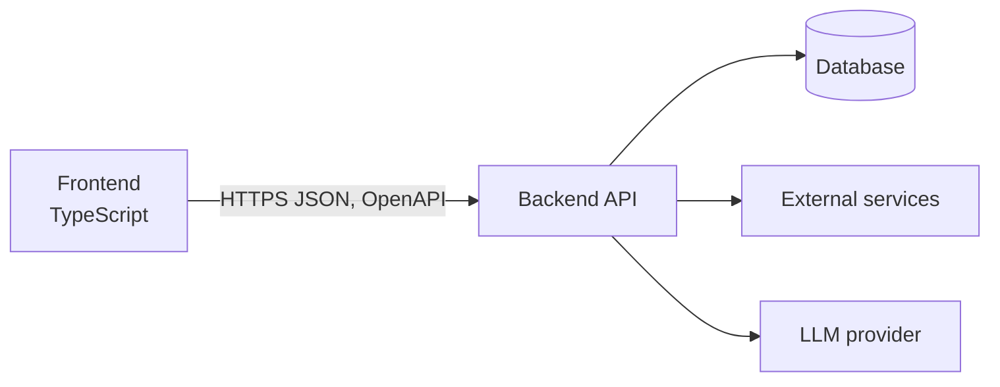

# <System name>: Architecture

Status: Draft | Approved by <name> on <YYYY-MM-DD>
Last updated: <YYYY-MM-DD>

## 1. Purpose and scope

What the system does, for whom, and what is explicitly out of scope.

## 2. Users, roles, and clients

| Role | Can do | Cannot do |
|---|---|---|
| | | |

Clients: browser UI / mobile / other services / partner API / CLI.

## 3. Components

| Component | Technology | Responsibility |
|---|---|---|
| Frontend | | Presentation, input, calling the backend API |
| Backend API | | Business rules, authorization, validation, persistence |
| Database | | |

Deviations from the approved stack: link ADRs.

## 4. Business rules and ownership

Every business rule, and the backend module that owns it. The frontend
never owns a rule (SEP-01).

| ID | Rule | Owning backend module | Notes |
|---|---|---|---|
| BR-1 | e.g. Orders over 500 get 5% discount | `services/pricing` | rate is configuration (CFG-03) |

## 5. Backend structure

Layers (see `backend-layering`): `api`, `services`, `domain`,
`infrastructure`. List the main modules in each.

## 6. API surface

Main resources and operations. Contract: `api/openapi.yaml`.

| Method | Path | Purpose | Authorization |
|---|---|---|---|
| | | | |

## 7. Data model

Main entities, ownership, sensitivity (PII, financial), retention.

## 8. Security

- Authentication: provider, protocol, token/session handling.
- Authorization model: roles/permissions, object-level ownership rules.
- Trust boundaries and where each check is enforced.
- Secrets: where stored, how injected.
- LLM-specific risks and mitigations, if applicable.

## 9. Configuration and prompts

- Configuration sources per environment; settings object.
- Business-tunable values and where they live.
- Prompt files: location, versioning, loader.

## 10. Testing strategy

Unit (domain/services), integration (DB, API), contract, end-to-end.
Which business rules are covered where.

## 11. Quality gates

Pre-commit hooks and required CI checks (see `quality-gates`).

## 12. Deployment and operations

Environments, artifact, migrations, logging/metrics/tracing, health
endpoints.

## 13. Deferred items

What is intentionally not done yet (e.g. for a prototype), and the risk.

## 14. Open questions

Questions for the human, with the decision once made.
